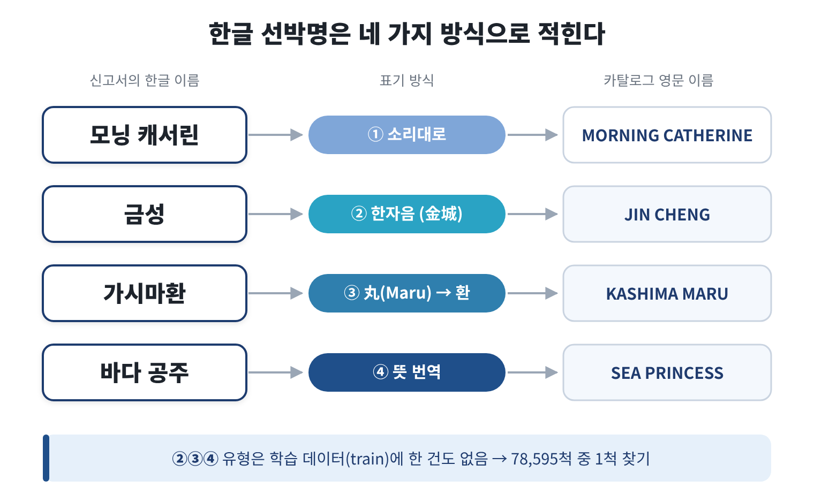
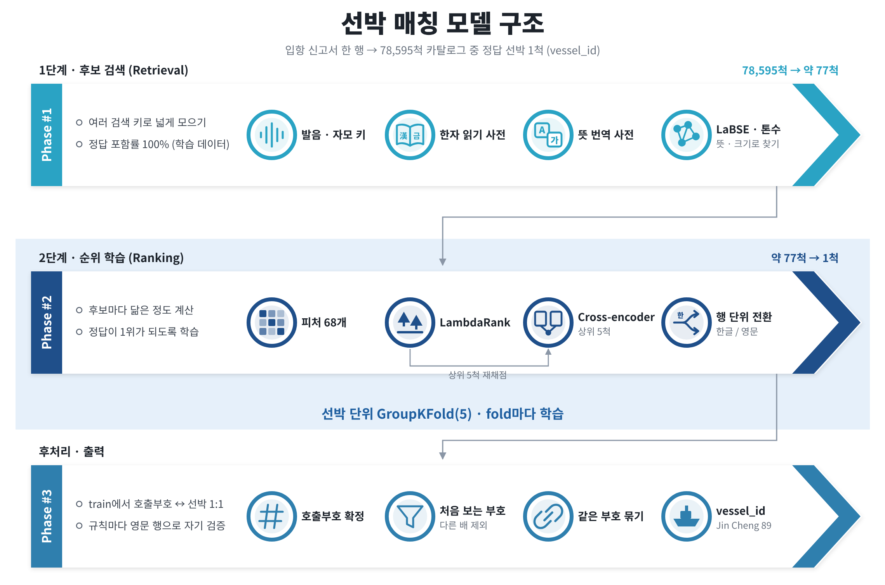

# 금성은 Jin Cheng인가: 한자 읽기·뜻 번역이 섞인 한글 선박명 매칭 모델

DACON [항만 문제해결을 위한 AI 기술 공모전](https://dacon.io/competitions/official/236771) 팀 참가 코드입니다.

수원대학교 데이터과학부 2026 DS-DAY에서 포스터로 발표해 **우수상**을 받았습니다.

📄 최종 포스터: [poster/DS-DAY_poster_final.pdf](poster/DS-DAY_poster_final.pdf)

<br>

## 한눈에 보기

| 항목 | 내용 |
|---|---|
| 팀 | 더블kim (김주호, 김하늘) · 지도교수 정진명 |
| 수상 | 2026 수원대 데이터과학부 DS-DAY **우수상** |
| 한글 선박명 정답 | 504 / 532행 (**94.7%**) |
| 영문 선박명 정답 | 3,429 / 3,568행 (96.1%) |
| 전체 | 3,933 / 4,100행 (95.9%) · 평가 점수 0.9515 |
| 대회 최종 제출 | Public LB **0.95240** (호출부호 후처리 포함) |

> 평가 데이터는 정답이 비공개라서, 정답 행 수는 제출 점수를 평가식으로 거꾸로 풀어 구했습니다.

**목차**: [문제](#무슨-문제였나) · [데이터](#데이터) · [모델 개요](#모델-개요) · [1단계 후보 검색](#1단계-후보-검색) · [직접 만든 사전](#직접-만든-사전) · [2단계 순위 학습](#2단계-순위-학습) · [결과](#결과) · [강건성](#강건성-분석) · [오답 분석](#오답-분석) · [결론](#결론과-향후-과제)

<br>

## 무슨 문제였나

**입항 신고서 한 행 → 선박 카탈로그 78,595척 중 정답 1척 찾기**

- 신고서의 선박명은 사람이 직접 적어서 표기가 제각각입니다.
- 카탈로그에는 **영어 이름만** 있습니다.

<p align="center"></p>

- ① 소리대로 적은 이름은 철자·발음 비교로 찾을 수 있습니다.
- ②③④는 **학습 데이터에 한 건도 없어서** 모델이 스스로 배울 수 없습니다.

<br>

**예시**: 신고서에 `금성 89호` · 2,980톤 · 중국 · 일반화물선

| vessel_id | 선박명 | 총톤수 | 비고 |
|---|---|---:|---|
| **VESSEL_44183** | **Jin Cheng 89** | **2,972** | **정답 (한자 읽기)** |
| VESSEL_61588 | Jin Cheng 3 | 2,965 | 숫자 다름 |
| VESSEL_72023 | Jin Cheng Zhou 18 | 2,943 | 이름 일부·숫자 다름 |
| VESSEL_57319 | Kum Song 7 | 2,888 | 소리만 비슷 |
| VESSEL_62317 | Kum Sung | 887 | 소리만 비슷 |

- 소리로만 찾으면 Kum Song이 먼저 걸립니다.
- 정답은 한자 읽기(金城 → 금성)로 이어지는 Jin Cheng 89입니다.
- 톤수와 숫자까지 함께 봐야 한 척으로 좁혀집니다.

<sub>신고서 행은 설명용 예시입니다.</sub>

<br>

## 데이터

| 데이터 | 규모 | 선박명 표기 |
|---|---:|---|
| 카탈로그 | 78,595척 | 모두 영문 (+ 총톤수, 국적, 선종) |
| 학습 | 12,222행 | 한글 1,191 · 영문 11,031, 정답 제공 |
| 평가 | 4,100행 | 한글 532 · 영문 3,568, 정답 비공개 |

- **평가식**: `0.7 × 한글 정확도 + 0.3 × 영문 정확도` → 한글 1행 ≈ 영문 16행
- **호출부호**: 학습 데이터에서 선박과 정확히 1:1 (5,851개 ↔ 5,851척)
- 대회 데이터는 DACON 규정상 저장소에 넣지 않았습니다.

<br>

## 모델 개요

철자·발음만 비교하면 '금성'을 GEUM SEONG과 비슷한 이름으로만 찾아서 정답을 놓칩니다. 그래서 두 단계로 나눴습니다.

| 단계 | 하는 일 | 규모 |
|---|---|---|
| 1. 후보 검색 | 여러 검색 키로 정답일 만한 배를 넓게 모음 | 78,595척 → 약 77척 |
| 2. 순위 학습 | 후보마다 '닮은 정도'를 계산해 1등을 고름 | 약 77척 → 1척 |

<p align="center"></p>

<br>

## 1단계: 후보 검색

검색 방법 7가지로 찾은 후보를 합칩니다.

- 행당 약 **77척**
- 학습 데이터 기준 정답 포함률 **100%**

| 검색 방법 | 하는 일 | 예시 |
|---|---|---|
| 발음 키 | 한글·영문을 같은 소리 문자열로 비교 | 모닝 캐서린 ↔ Morning Catherine |
| **한자 읽기 키** 📖 | 병음을 한국식 한자음으로 펼침 | Jin Cheng → 금성, 진성 … |
| 마루 키 📖 | 일본 배의 丸 표기 통일 | 가시마환 → 가시마마루 |
| **뜻 번역 키** 📖 | 영어 단어를 뜻으로 번역 | Ocean Star → 해양성 |
| LaBSE 검색 | 다국어 임베딩, 쌍 데이터로 파인튜닝 | 바다 공주 ↔ Sea Princess |
| 톤수 범위 | 총톤수 ±5.5% 안에서 이름이 가까운 배 | 2,980톤 → 2,816~3,144톤 |
| 정확 일치·같은 톤수 | 이름이 같거나, 개명했어도 톤수가 같은 배 | CENTRAL PARK → Caifu Chao |

<sub>📖 = 직접 만든 사전을 쓰는 방법</sub>

<br>

## 직접 만든 사전

학습 데이터에 0건인 표기를 찾으려고 사전 두 개를 직접 만들었습니다.

- 일반 언어 지식만 넣었고, 선박명이나 정답은 넣지 않았습니다.
- 코드: [`inference/model/hanja.py`](inference/model/hanja.py)

| | 한자 읽기 사전 | 뜻 번역 사전 |
|---|---|---|
| 규모 | 병음 음절 349개 + 두음법칙 36개 | 영단어 486개 |
| 단어 예시 | `jin` → 금·진·근<br>`cheng` → 성·정·승 | `ocean` → 해양·바다<br>`star` → 성·별 |
| 이름 예시 | Jin Cheng → 금성, 진성, 근정 …<br>가시마환 → 가시마마루 | Ocean Star → 해양성<br>Sea Princess → 바다 공주 |
| 효과 (한글 정답) | **+15행** (마루 포함) | **+8행** |

> 두 사전으로 한글 정답 **460 → 483행**

<br>

## 2단계: 순위 학습

### 피처와 랭커

- **피처 68개**: 이름·발음·한자 읽기 유사도, 톤수 차이, 국적·선종 일치, 임베딩 유사도, 후보 간 상대 순위
- **LightGBM LambdaRank**: 정답이 1등에 오도록 순위 자체를 학습 (트리 600개, 시드 3개 앙상블)

### 크로스인코더 (한글 행만)

두 이름을 함께 읽는 모델로, **상위 5척만** 다시 채점합니다.

- 77척을 다 채점하면 계산이 약 15배 → 상위 5척으로 제한
- 한글 행의 약 97%는 정답이 이미 상위 5척 안에 있음
- 결과: 한글 정답 **499 → 504행**

```python
# 랭커 점수에 한글 기록만 cross-encoder 점수를 더함 (vessel_lib.py)
sc = self.booster.predict(X)
if CE is not None and q.hangul and len(cands) > 1:
    top = np.argsort(-sc, kind="stable")[:CE_TOP]        # 상위 5척
    sc[top] += CE_W * CE.score(row.get("vessel_name"), self.idx.names[cands[top]])
```

### 행 단위 모델 전환

- 문제: 한글 성능을 올린 파인튜닝·크로스인코더가 영문 정답을 **3,429 → 3,375행**으로 떨어뜨림
- 해결: 한글 행은 한글에 강한 모델, 영문 행은 이전 모델로 채점
- 결과: 한글 504행, 영문 3,429행을 **둘 다 유지**

### 학습 데이터 보강

규칙과 LLM으로 학습 선박명을 바꿔 쓴 기록 **12,014개**를 더했습니다.

- 규칙: 자모 오타, 띄어쓰기, 톤수 결측 ([`training/augment.py`](training/augment.py))
- LLM: Qwen2.5-7B가 소리·한자음·뜻 등 5가지 방식으로 다시 씀 ([`llm_synthetic/`](llm_synthetic/))

### 검증

- **선박 단위 GroupKFold(5)**: 같은 배가 학습과 검증에 같이 들어가지 않게
- LaBSE, 크로스인코더, 보조 사전도 fold마다 따로 만듦

<br>

## 결과

<p align="center"></p>

- 평가 점수 **0.883 → 0.9515**
- 늘어난 한글 정답 44행 중 **23행(52%)이 두 사전**에서 나옴
- 영문 수치는 단계마다 랭커를 다시 학습해서 오르내렸고, 마지막에 영문 최고 모델로 되돌림

**대회 최종 제출: Public LB 0.95240** (한글 504, 영문 3,440)

- 위 모델 + 영문 랭커 앙상블(3개 → 9개) + 호출부호 후처리
- 호출부호 후처리: 학습 데이터에 없는 호출부호는 학습 데이터의 배가 될 수 없다는 규칙 등
- 규칙마다 영문 행으로 먼저 확인하고, 맞지 않으면 스스로 꺼지게 함 ([`inference/script.py`](inference/script.py))

**정답 행 수를 알아낸 방법**

- 대회 서버는 총점만 알려 줍니다.
- 한글 1행과 영문 1행이 총점에 주는 크기가 달라서, `0.7·h/532 + 0.3·e/3568`을 거꾸로 풀면 h, e가 한 가지로 나옵니다.

<br>

## 강건성 분석

검증 행에 톤수 삭제·자모 오타 같은 손상을 일부러 넣고 다시 채점했습니다 ([`training/stress_eval.py`](training/stress_eval.py)).

<p align="center"></p>

| 조건 | 한글 | 영문 |
|---|---:|---:|
| 원본 | 99.66% | 99.95% |
| 톤수 제거 | 99.58% | 99.75% |
| 자모 오타 | 99.50% | 99.95% |
| 선박명만 남김 | 97.40% | 99.75% |
| 손상 2~3개 동시 | **86.90%** | 96.20% |

> 단서 하나가 빠지는 것보다, **여러 손상이 겹칠 때** 하락이 훨씬 큽니다.

<sub>선박 단위 5-fold 검증, 개발 단계 모델 기준</sub>

<br>

## 오답 분석

<p align="center"></p>

한글 532행 중 남은 오답 28행에서 정답 배가 몇 위였는지 봤습니다.

| 정답 순위 | 행 수 | 근거 |
|---|---:|---|
| 2위 | 6 | 모든 행에 2등 후보를 제출해서 확인 |
| 3~5위 | 약 6 | 추정 |
| 5위 밖 | 약 16 | 추정 |

- 후보를 30~50척으로 넓혀도 정답 수가 그대로였습니다.
- 그래서 원인은 후보를 못 찾은 게 아니라 **순위를 가를 정보 부족**으로 판단했습니다.
- 대표 사례: 자매선(같은 설계로 크기까지 같은 배), 이름을 바꾼 배

<br>

## 결론과 향후 과제

**결론**

- 직접 만든 한자 읽기·뜻 번역 사전으로 한글 정답 **+23행**
- 크로스인코더를 상위 5척에만 써서 계산량 약 **1/15**
- 한글·영문 행마다 모델을 따로 써서 한글 +5행과 영문 3,429행을 모두 유지

**향후 과제**

- 자매선·개명 선박을 구분할 순위 피처 보강
- 여러 정보가 함께 손상된 기록으로 학습 데이터 보강

<br>

## 폴더 구조

```
inference/            최종 제출 코드 (DACON 서버에서 실행)
  script.py           시작점, 호출부호 후처리
  model/vessel_lib.py 정규화, 후보 검색, 피처 68개, Matcher
  model/hanja.py      한자 읽기 사전, 마루 처리, 뜻 번역 사전
  model/emb_feat.py   LaBSE 임베딩 피처
  model/ce_feat.py    크로스인코더 재채점
training/             학습, 검증, 분석 스크립트
  train.py            랭커 학습, CV, 제출 zip 생성
  augment.py          규칙 기반 증강
  stress_eval.py      손상 조건별 검증
labse_finetune/       LaBSE 파인튜닝 (Kaggle 노트북 포함)
cross_encoder/        크로스인코더 학습 (Kaggle 노트북 포함)
llm_synthetic/        LLM으로 한글 기록 생성
llm_transliteration/  카탈로그 한글 표기 생성, LLM 객관식 채점 실험
analysis/             강건성 분석 요약, 학습 곡선
poster/               DS-DAY 최종 포스터(PDF)와 그림
docs/                 미팅 자료, 모델 구조 정리
```

<br>

## 실행 방법

대회 데이터(`train.csv`, `vessel_catalog.csv`, `test.csv`)와 학습된 가중치는 저장소에 없습니다. 데이터는 DACON 대회 페이지에서 받아야 합니다.

```bash
pip install pandas numpy lightgbm rapidfuzz scikit-learn
python training/train.py --data <대회 데이터 폴더>
```

<br>

## 사용 기술

`Python` `pandas` `LightGBM (LambdaRank)` `rapidfuzz` `PyTorch` `Hugging Face Transformers` `LaBSE` `cross-encoder` `Qwen2.5` `Kaggle GPU`

<br>

## 참고문헌

팀 프로젝트입니다. 한글 기록용 랭커와 크로스인코더 조합 등 일부는 팀원의 작업을 바탕으로 했습니다.

1. Ke, G. et al. (2017). LightGBM: A highly efficient gradient boosting decision tree. NeurIPS 30.
2. Burges, C. J. C. (2010). From RankNet to LambdaRank to LambdaMART: An overview. MSR-TR-2010-82.
3. Feng, F. et al. (2022). Language-agnostic BERT sentence embedding. ACL 2022.
4. Nogueira, R., & Cho, K. (2019). Passage re-ranking with BERT. arXiv:1901.04085.
5. Fellegi, I. P., & Sunter, A. B. (1969). A theory for record linkage. JASA, 64(328).
6. Qwen Team (2024). Qwen2.5 technical report. arXiv:2412.15115.
