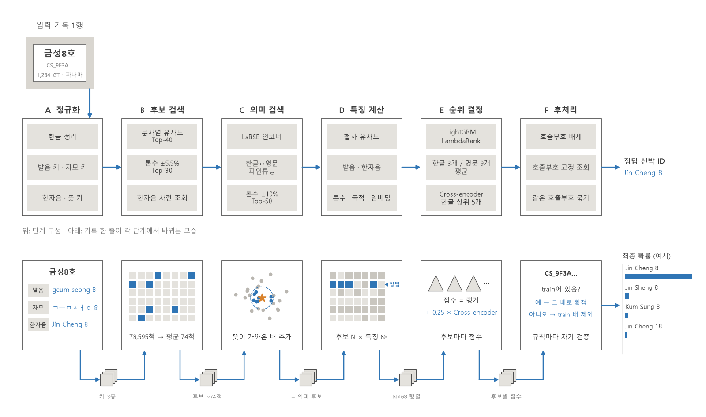

# 항만 입출항 기록 ↔ 선박 카탈로그 매칭 (DACON)

모델 이름: DS데이_선박매칭_검색랭킹모델
미팅 자료: [docs/DS데이_선박매칭_검색랭킹모델.md](docs/DS데이_선박매칭_검색랭킹모델.md)

[DACON 경진대회 236771](https://dacon.io/competitions/official/236771)에 팀으로 참가하면서 작성한 코드입니다. 항만 입출항 기록 한 줄을 보고, 약 7만 9천 척이 들어 있는 선박 카탈로그에서 같은 배를 찾는 문제였습니다.

최종 Public LB는 0.95240입니다(2026-11-01, 코드 제출). 평가식은 `0.7 × 한글 기록 정확도 + 0.3 × 영문 기록 정확도`이고, 점수를 역산해 보면 한글 532행 중 504행(94.7%), 영문 3,568행 중 3,440행(96.4%)을 맞혔습니다.

## 어려웠던 점

카탈로그에는 영문 이름만 있는데, 기록의 선박명은 한글로 적힌 경우가 많았습니다. 그 한글 표기도 제각각이었습니다. 소리 나는 대로 적은 이름(`케이엠티씨 선전` → `KMTC Shenzhen`)도 있고, 중국 배 이름을 한자음으로 읽어 적은 이름(예: `금성` → `Jin Cheng`)도 있었습니다. 뜻을 번역해서 적은 이름(`해풍` → `Sea Wind`)도 있었습니다.

영문 기록에는 오타가 섞여 있었고(`GRAND VICCTORY`), 톤수나 국적이 빠진 기록도 있어서 이름만 보고 골라야 하는 경우도 있었습니다.

## 접근 방법

명부 전체에서 후보를 먼저 추리고, 학습한 모델이 그 후보들의 순위를 매기는 방식으로 풀었습니다. 마지막에는 호출부호 규칙으로 한 번 더 점검합니다.

<p align="center"></p>

<p align="center"></p>

위 그림에서 윗줄은 단계 구성이고, 아랫줄은 기록 하나가 각 단계를 지나면서 어떻게 바뀌는지를 보여 줍니다. 단계별 설명은 [docs/model_structure.md](docs/model_structure.md)에, 공부 순서는 [docs/study_plan.md](docs/study_plan.md)에 정리했습니다.

### 한글 표기 맞추기
`inference/model/vessel_lib.py`, `hanja.py`

한글 선박명을 로마자 발음 키와 자모 키로 바꿔서 영문 이름과 비교했습니다. 중국 선박명은 한자음 표를 따로 만들어 처리했습니다. 예를 들어 `jin`은 `금/진`, `cheng`은 `성`에 대응하므로 `Jin Cheng`을 `금성`과 연결할 수 있습니다. `케이엠티씨`를 `KMTC`로 읽는 것처럼 약어를 풀어 쓰는 경우와, `STI`를 `에스티아이`로 읽는 대문자 약어도 처리했습니다.

### 순위 학습
`training/train.py`

후보마다 68개의 특징을 계산하고, LightGBM LambdaRank로 정답이 1위에 오도록 학습했습니다. 한글 기록과 영문 기록은 서로 다른 모델이 맡습니다(`RowTypeSwitch`). 검증은 선박 단위 GroupKFold(5)로 해서, 학습 때 본 배가 검증에 섞이지 않게 했습니다.

### 데이터 증강
train의 한글 기록이 1,191행뿐이라 데이터를 늘렸습니다. `training/augment.py`에서는 자모 오타, 띄어쓰기 변화, 톤수 오차와 결측을 일부러 만들었습니다. `llm_synthetic/`에서는 Qwen2.5-7B-Instruct로 train 선박명을 다섯 가지 방식의 한글로 다시 써서 학습에 추가했습니다. 대회 규칙상 train 데이터를 바탕으로 한 증강만 허용되어 그 안에서만 만들었습니다.

### 신경망 (Kaggle GPU)
LaBSE는 (한글 기록, 영문 선박명) 쌍으로 파인튜닝해서, 뜻을 번역해 적은 이름을 찾는 데 썼습니다(`labse_finetune/`). cross-encoder는 랭커가 헷갈려 한 후보를 오답 예시로 넣어 학습했고, 한글 기록의 상위 5개 후보를 다시 채점하는 데 씁니다(`cross_encoder/`).

### 호출부호 후처리
`inference/script.py`의 `callsign_postprocess`

train을 보면 호출부호와 선박이 정확히 1:1로 대응합니다(5,851개와 5,851척). 그래서 train에 있는 호출부호가 test에 나오면 그 배로 정하고, train에 없는 호출부호라면 train에서 이미 다른 호출부호를 쓰던 배는 후보에서 뺐습니다. 같은 호출부호를 가진 test 기록끼리는 확률을 합쳐서 같은 배로 정했습니다.

test에서도 이 규칙이 맞는다는 보장은 없어서, 영문 기록으로 먼저 확인하고 어긋나는 경우가 많으면 규칙이 꺼지도록 했습니다. 이 후처리로 LB가 0.95147에서 0.95240이 되었습니다.

## 스트레스 테스트
`training/stress_eval.py`

로컬 CV는 0.99를 넘는데 LB는 그보다 꽤 낮게 나왔습니다. 원인을 찾으려고 검증 데이터에 일부러 손상을 넣고 다시 채점해 봤습니다.

| 조건 | 한글 정확도 | 영문 정확도 |
|---|---|---|
| 원본 | 99.66% | 99.95% |
| 톤수 제거 | 99.58% | 99.75% |
| 한글 자모 오타 | 99.50% | 99.95% |
| 이름만 남김 (톤수·국적·선종 제거) | 97.40% | 99.75% |
| 손상 2~3개 동시 | 86.90% | 96.20% |

버전별 결과는 `analysis/stress_summary_*.csv`에 있습니다.

## 리더보드 분석

LB 점수를 평가식(`0.7·h/532 + 0.3·e/3568`)에 맞춰 거꾸로 풀면 제출마다 한글과 영문을 몇 개씩 맞혔는지 알 수 있습니다. 이렇게 확인해 보니 한글은 거의 모든 제출에서 504개로 같았고, 점수가 오른 건 대부분 영문 덕분이었습니다.

톤수 노이즈나 같은 이름을 가진 배 때문에 틀리는 것은 아닌지도 의심했지만, LB 제출과 시뮬레이션으로 확인해 보니 원인이 아니었습니다. 남은 한글 오답은 대부분 표기가 너무 자유로운 경우였고, 28건 중 16건 정도는 정답이 상위 5개 후보에도 들지 못했습니다.

## 폴더 구조

```
inference/            최종 제출 코드 (DACON 서버에서 실행)
  script.py           시작점, 호출부호 후처리
  model/vessel_lib.py 정규화, 후보 검색, 특징 68개, Matcher
  model/hanja.py      병음과 한자음 대응표
  model/emb_feat.py   LaBSE 임베딩 특징
  model/ce_feat.py    cross-encoder 재채점
training/             학습, 검증, 분석 스크립트
  train.py            랭커 학습, CV, 제출 zip 생성
  augment.py          규칙 기반 증강
  stress_eval.py      손상 조건별 검증
labse_finetune/       LaBSE 파인튜닝 (Kaggle 노트북 포함)
cross_encoder/        cross-encoder 학습 (Kaggle 노트북 포함)
llm_synthetic/        LLM으로 한글 기록 생성
llm_transliteration/  카탈로그 한글 표기 생성, LLM 객관식 채점 실험
analysis/             스트레스 테스트 요약, 학습 곡선
docs/                 미팅 자료, 모델 구조 정리, 공부 계획
```

## 실행 방법

대회 데이터(`train.csv`, `vessel_catalog.csv`, `test.csv`)는 DACON 규정 때문에 저장소에 넣지 않았습니다. 학습된 가중치도 용량이 커서 제외했습니다.

```bash
pip install pandas numpy lightgbm rapidfuzz scikit-learn
python training/train.py --data <대회 데이터 폴더>
```

## 사용 기술
Python, pandas, LightGBM (LambdaRank), rapidfuzz, PyTorch, Hugging Face Transformers (LaBSE, cross-encoder), Qwen2.5, Kaggle GPU

## 참고
팀 프로젝트입니다. 한글 기록용 랭커와 cross-encoder 조합 등 일부는 팀원의 작업을 바탕으로 했습니다.
