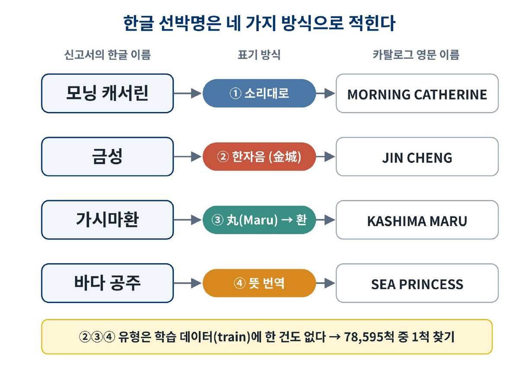
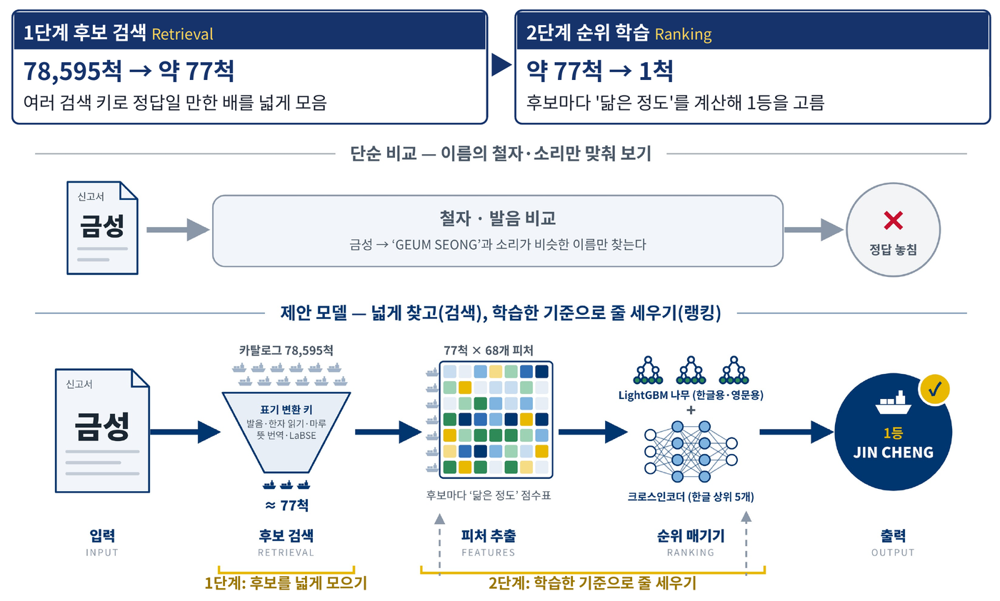
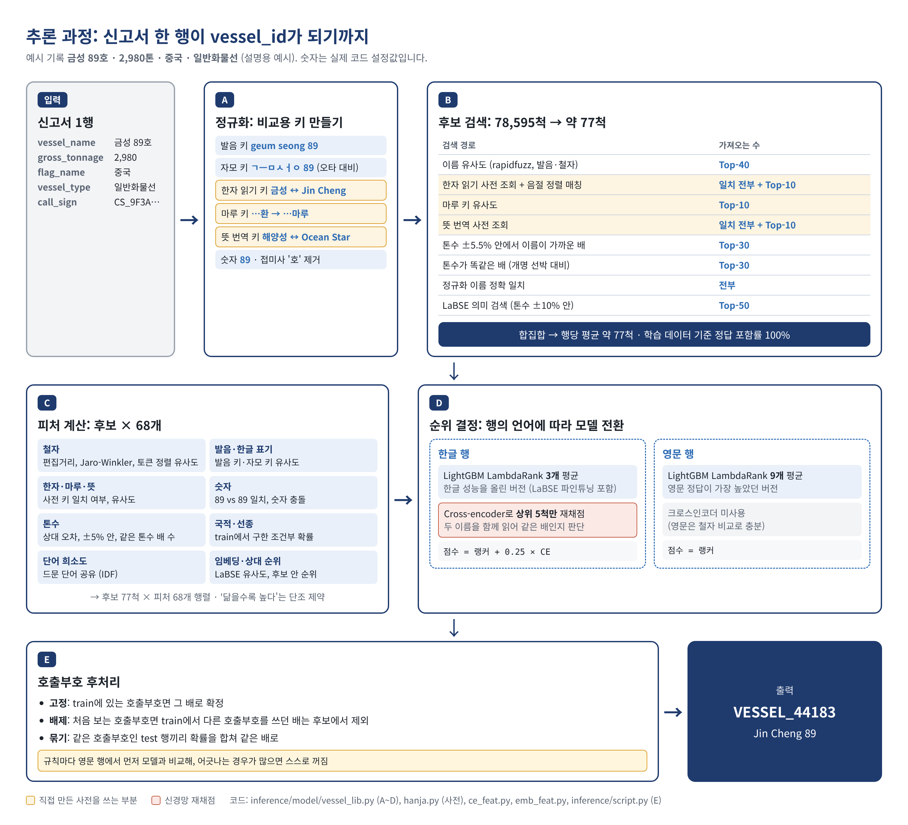
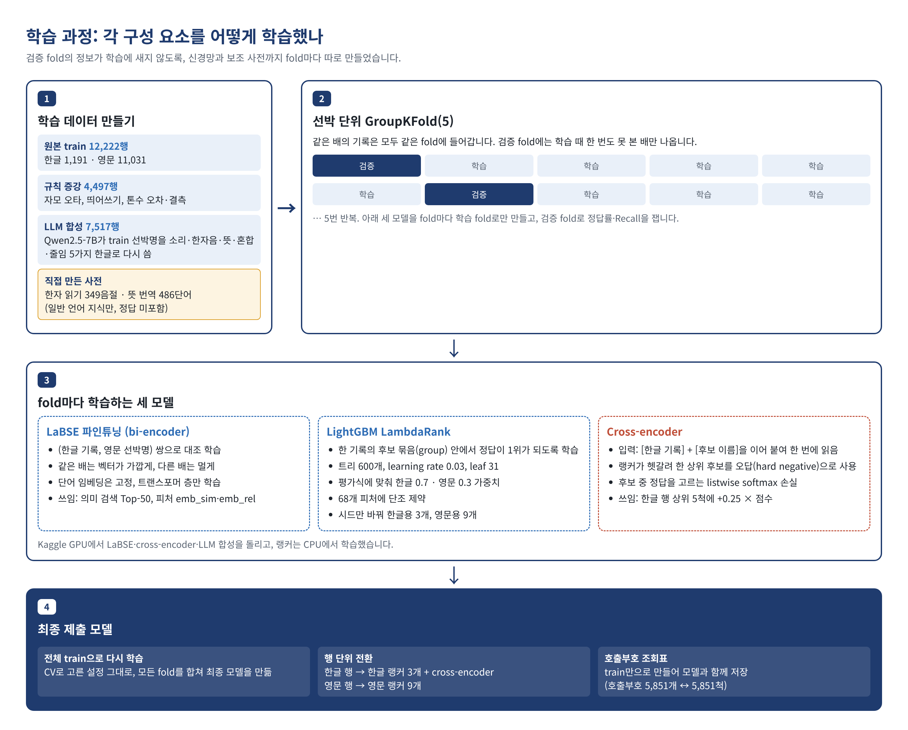
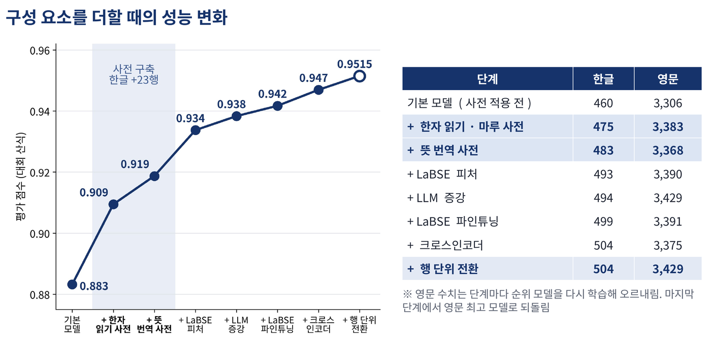
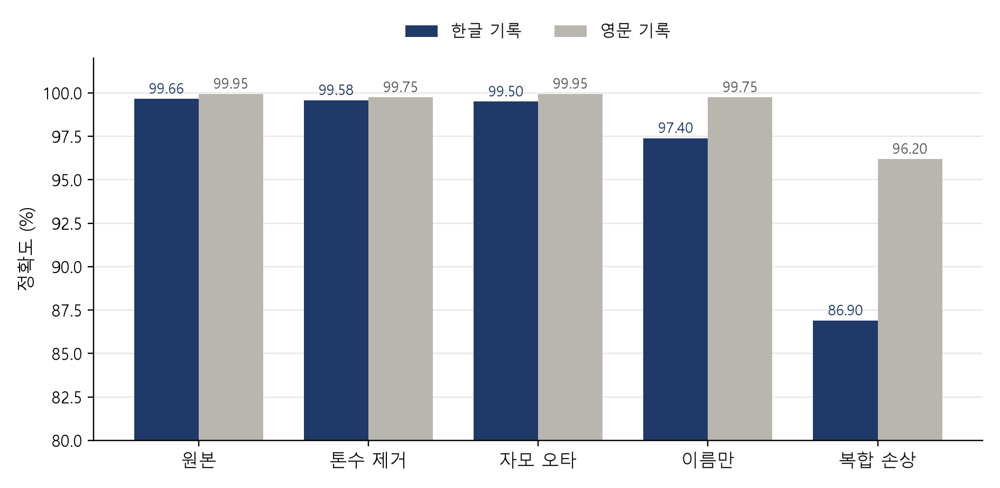
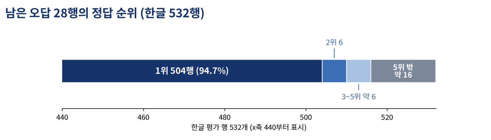

# 금성은 Jin Cheng인가: 한자 읽기·뜻 번역이 섞인 한글 선박명 매칭 모델

DACON [항만 문제해결을 위한 AI 기술 공모전](https://dacon.io/competitions/official/236771)에 팀으로 참가해서 만든 코드입니다.
같은 내용으로 수원대학교 데이터과학부 2026 DS-DAY에서 포스터 발표를 했고, **우수상**을 받았습니다.

📄 최종 포스터: [poster/DS-DAY_poster_final.pdf](poster/DS-DAY_poster_final.pdf)

| | |
|---|---|
| 팀 | 더블kim (김주호, 김하늘) · 지도교수 정진명 |
| 수상 | 2026 수원대학교 데이터과학부 DS-DAY **우수상** |
| 한글 선박명 정답 | 532행 중 504행 (**94.7%**) |
| 영문 선박명 정답 | 3,568행 중 3,429행 (96.1%) |
| 전체 | 4,100행 중 3,933행 (95.9%) · 평가 점수 0.9515 |
| 최종 제출 (호출부호 후처리 포함) | Public LB **0.95240** |

평가 데이터는 정답이 공개되지 않아서, 정답 행 수는 제출 점수를 평가식으로 거꾸로 풀어 구했습니다 ([결과](#결과) 참고).

<br>

## 무슨 문제였나

배가 항구에 들어올 때 내는 입항 신고서에는 사람이 직접 적은 선박명이 들어갑니다. 이 신고서 한 행을 보고, 공식 선박 카탈로그 78,595척 중 정확히 어느 배인지 한 척을 찾는 문제입니다.

카탈로그에는 영어 이름만 있는데, 신고서의 한글 선박명은 네 가지 방식으로 적혀 있었습니다.

<p align="center"></p>

소리대로 적은 이름은 철자나 발음을 비교하면 찾을 수 있습니다. 하지만 한자를 우리식으로 읽거나(金城 Jin Cheng → 금성), 일본 배의 丸(마루)를 '환'으로 쓰거나, 뜻을 번역한(Sea Princess → 바다 공주) 이름은 학습 데이터에 한 건도 없어서 모델이 스스로 배울 수가 없었습니다.

예를 들어 신고서에 `금성 89호`, 2,980톤, 중국, 일반화물선이라고 적혀 있으면 카탈로그에는 이런 후보들이 있습니다.

| vessel_id | 선박명 | 총톤수 | 비고 |
|---|---|---|---|
| **VESSEL_44183** | **Jin Cheng 89** | **2,972** | **정답 (한자 읽기)** |
| VESSEL_61588 | Jin Cheng 3 | 2,965 | 숫자 다름 |
| VESSEL_72023 | Jin Cheng Zhou 18 | 2,943 | 이름 일부·숫자 다름 |
| VESSEL_57319 | Kum Song 7 | 2,888 | 소리만 비슷 |
| VESSEL_62317 | Kum Sung | 887 | 소리만 비슷 |

소리로만 찾으면 Kum Song이 먼저 걸리지만, 정답은 한자 읽기로 이어지는 Jin Cheng 89입니다. 톤수와 숫자까지 같이 봐야 한 척으로 좁혀집니다. (신고서 행은 설명용 예시입니다.)

<br>

## 데이터

| 데이터 | 규모 | 선박명 표기 |
|---|---|---|
| 카탈로그 | 78,595척 | 모두 영문 (+ 총톤수, 국적, 선종) |
| 학습 | 12,222행 | 한글 1,191행 · 영문 11,031행, 정답 제공 |
| 평가 | 4,100행 | 한글 532행 · 영문 3,568행, 정답 비공개 |

- 평가식은 `0.7 × 한글 정확도 + 0.3 × 영문 정확도`라서 한글 1행이 영문 약 16행만큼의 점수입니다.
- 학습 데이터에서 호출부호와 선박은 정확히 1:1입니다 (5,851개와 5,851척).
- 대회 데이터는 DACON 규정상 재배포할 수 없어서 저장소에 넣지 않았습니다.

<br>

## 모델 개요

철자·발음만 비교하면 '금성'을 GEUM SEONG과 비슷한 이름으로만 찾아서 정답을 놓칩니다. 그래서 두 단계로 나눴습니다.

1. **후보 검색 (78,595척 → 약 77척)**: 여러 검색 키로 정답일 만한 배를 넓게 모읍니다.
2. **순위 학습 (약 77척 → 1척)**: 후보마다 '닮은 정도'를 계산해서 1등을 고릅니다.

<p align="center"></p>

<br>

## 1단계: 후보 검색

검색 방법 일곱 가지로 찾은 후보를 합칩니다. 합치면 행당 약 77척이고, 학습 데이터 기준으로 정답이 후보에 들어가는 비율은 100%입니다.

| 검색 방법 | 하는 일 | 예시 |
|---|---|---|
| 발음 키 | 한글·영문을 같은 소리 문자열로 바꿔 비교 | 모닝 캐서린 ↔ Morning Catherine |
| **한자 읽기 키** | 병음을 한국식 한자음으로 펼침 | Jin Cheng → 금성, 진성 … |
| 마루 키 | 일본 배의 丸 표기 통일 | 가시마환 → 가시마마루 |
| **뜻 번역 키** | 영어 단어를 뜻으로 번역 | Ocean Star → 해양성 |
| LaBSE 검색 | 다국어 임베딩, 쌍 데이터로 파인튜닝 | 바다 공주 ↔ Sea Princess |
| 톤수 범위 검색 | 총톤수 ±5.5% 안에서 이름이 가까운 배 | 2,980톤 → 2,816~3,144톤 |
| 정확 일치·같은 톤수 | 이름이 같은 배, 이름을 바꿨어도 톤수가 같은 배 | CENTRAL PARK → Caifu Chao |

굵게 표시한 두 가지는 직접 만든 사전을 씁니다.

<br>

## 직접 만든 사전

학습 데이터에 0건인 표기를 찾으려고, 일반 언어 지식만으로 사전 두 개를 만들었습니다. 선박명이나 정답은 넣지 않았습니다. 코드는 [`inference/model/hanja.py`](inference/model/hanja.py)에 있습니다.

**한자 읽기 사전**
- 병음 음절 349개 → 한국식 한자음, 두음법칙 36개
- `jin` → 금·진·근, `cheng` → 성·정·승
- Jin Cheng → 금성, 진성, 근정 …
- 가시마환 → 가시마마루 (丸)

**뜻 번역 사전**
- 자주 쓰는 영단어 486개 → 한국어 뜻
- `ocean` → 해양·바다, `star` → 성·별
- Ocean Star → 해양성, Sea Princess → 바다 공주

두 사전을 넣고 한글 정답이 460행에서 483행으로 늘었습니다 (한자 읽기·마루 +15, 뜻 번역 +8).

<br>

## 2단계: 순위 학습

- **피처 68개**: 이름·발음·한자 읽기 유사도, 톤수 차이, 국적·선종 일치, 임베딩 유사도, 후보 간 상대 순위
- **LightGBM LambdaRank**: 정답이 1등에 오도록 순위 자체를 학습합니다 (트리 600개, 시드 3개 앙상블).
- **크로스인코더 (한글 행)**: 두 이름을 함께 읽는 모델로 상위 5개만 다시 채점합니다.
  - 후보마다 모델을 한 번씩 돌려야 해서 77척을 다 채점하면 계산이 약 15배입니다. 한글 행의 약 97%는 정답이 이미 상위 5개 안에 있어서 5개면 충분했습니다.
  - 77척을 다시 고르지 않고 상위 5개의 순서만 조정해서 한글 정답이 499행에서 504행이 됐습니다.
- **행 단위 모델 전환**: 이름이 한글인 행은 한글에 강한 순위 모델이, 영문인 행은 영문에 강한 모델이 채점합니다.
  - 한글 성능을 올린 파인튜닝과 크로스인코더가 영문 정답을 3,429행에서 3,375행으로 떨어뜨렸습니다. 그래서 영문 행만 이전 모델로 채점해 한글 504행, 영문 3,429행을 둘 다 유지했습니다.
- **학습 데이터 보강**: 학습 선박명을 규칙(자모 오타, 띄어쓰기, 톤수 결측)과 LLM(Qwen2.5-7B)으로 바꿔 쓴 기록 12,014개를 더했습니다 ([`training/augment.py`](training/augment.py), [`llm_synthetic/`](llm_synthetic/)).

```python
# 랭커 점수에 한글 기록만 cross-encoder 점수를 더함 (vessel_lib.py)
sc = self.booster.predict(X)
if CE is not None and q.hangul and len(cands) > 1:
    top = np.argsort(-sc, kind="stable")[:CE_TOP]        # 상위 5척
    sc[top] += CE_W * CE.score(row.get("vessel_name"), self.idx.names[cands[top]])
```

**검증**: 같은 배가 학습과 검증에 같이 들어가면 외워서 맞히게 되므로 선박 단위 GroupKFold(5)로 검증했습니다. LaBSE, 크로스인코더, 보조 사전도 fold마다 따로 만들었습니다.

<br>

## 모델 구조 자세히 보기

포스터의 모델 개요는 흐름만 보여 줘서, 실제 코드가 기록 한 행을 어떻게 처리하는지와 각 모델을 어떻게 학습했는지를 따로 그렸습니다. 그림 속 숫자는 모두 코드에 들어 있는 실제 설정값입니다.

### 추론: 신고서 한 행이 vessel_id가 되기까지

<p align="center"></p>

`금성 89호 · 2,980톤 · 중국`을 예로 따라가 보면 이렇습니다.

1. **정규화 (A)**: 이름에서 '호'를 떼고 숫자 89를 따로 둡니다. 발음 키 `geum seong 89`, 자모 키, 그리고 사전으로 만든 한자 읽기 키(`금성` ↔ `Jin Cheng`)가 생깁니다.
2. **후보 검색 (B)**: 발음이 비슷한 Kum Song 같은 배는 이름 유사도 Top-40으로, Jin Cheng 89는 한자 읽기 사전 조회로, 톤수가 비슷한 배는 ±5.5% 창으로 들어옵니다. 모든 경로의 결과를 합치면 평균 77척 정도가 남습니다.
3. **피처 계산 (C)**: 77척 각각에 대해 철자·발음·한자 읽기 유사도, 숫자 89 일치 여부, 톤수 오차(2,980 vs 2,972 → 0.3%) 등 68개 숫자를 계산합니다.
4. **순위 결정 (D)**: 한글 행이므로 한글 랭커 3개의 평균 점수를 매기고, 상위 5척만 cross-encoder가 두 이름을 함께 읽어 다시 채점합니다. 최종 점수는 `랭커 + 0.25 × CE`입니다.
5. **호출부호 후처리 (E)**: 호출부호가 train에 있으면 그 배로 확정하고, 처음 보는 호출부호면 이미 다른 호출부호를 쓰던 배를 후보에서 뺍니다.

### 학습: 각 구성 요소를 어떻게 만들었나

<p align="center"></p>

- 세 모델(LaBSE, LambdaRank, cross-encoder)과 보조 사전은 **fold마다 학습 fold로만** 만들었습니다. 검증 fold의 배가 어디에도 새지 않아야 처음 보는 배에 대한 성능을 제대로 잴 수 있기 때문입니다.
- cross-encoder는 랭커가 헷갈려 한 상위 후보를 오답으로 넣어 학습했습니다. 그래서 랭커가 1등과 2등을 잘 못 가르는 경우를 보완합니다.
- 최종 제출 모델은 CV로 고른 설정 그대로 전체 train으로 다시 학습했습니다.

단계별 코드 위치와 예상 질의응답은 [docs/model_structure.md](docs/model_structure.md)에 정리했습니다.

<br>

## 결과

<p align="center"></p>

평가 점수는 0.883에서 0.9515까지 올랐고, 늘어난 한글 정답 44행 중 23행(52%)이 두 사전에서 나왔습니다. 영문 수치는 단계마다 순위 모델을 다시 학습해서 오르내렸고, 마지막 단계에서 영문 최고 모델로 되돌렸습니다.

**대회 최종 제출**은 이 모델에 영문 랭커 앙상블(3개 → 9개)과 호출부호 후처리를 더한 것으로, Public LB 0.95240(한글 504, 영문 3,440)입니다. 호출부호 후처리는 학습 데이터에 없는 호출부호는 학습 데이터의 배가 될 수 없다는 규칙 등을 적용하고, 규칙마다 영문 행으로 먼저 확인해서 맞지 않으면 스스로 꺼지게 했습니다 ([`inference/script.py`](inference/script.py)의 `callsign_postprocess`).

**정답 행 수를 알아낸 방법**: 대회 서버는 총점만 알려 줍니다. 한글 1행과 영문 1행이 총점에 주는 크기가 달라서, 총점을 `0.7·h/532 + 0.3·e/3568`에 넣고 거꾸로 풀면 한글 정답 h와 영문 정답 e가 한 가지로만 나옵니다.

<br>

## 강건성 분석

검증 행에 톤수 삭제, 자모 오타 같은 손상을 일부러 넣고 다시 채점했습니다 ([`training/stress_eval.py`](training/stress_eval.py)).

<p align="center"></p>

| 조건 | 한글 | 영문 |
|---|---:|---:|
| 원본 | 99.66% | 99.95% |
| 톤수 제거 | 99.58% | 99.75% |
| 자모 오타 | 99.50% | 99.95% |
| 선박명만 남김 | 97.40% | 99.75% |
| 손상 2~3개 동시 | 86.90% | 96.20% |

선박명만 남겨도 한글 97.4%를 맞혔지만, 손상 2~3개가 겹치면 86.9%로 떨어졌습니다. 보조 단서 하나가 빠질 때보다 여러 손상이 겹칠 때 하락이 큽니다. (선박 단위 5-fold 검증, 개발 단계 모델 기준)

<br>

## 오답 분석

<p align="center"></p>

평가 데이터의 한글 532행 중 남은 오답 28행에서 정답 배가 몇 위였는지 봤습니다.

- 2위: 6행. 모든 행에 2등 후보를 답으로 제출해서 확인했습니다.
- 3~5위: 약 6행, 5위 밖: 약 16행 (추정치)

후보를 30~50척으로 넓혀도 정답 수가 변하지 않아서, 오답의 주원인은 후보를 못 찾은 게 아니라 순위를 가를 정보가 부족한 것이라고 판단했습니다. 자매선(같은 설계로 만들어 크기까지 같은 배)이나 이름을 바꾼 배가 대표적입니다.

<br>

## 결론과 향후 과제

- 학습 데이터에 없는 표기를 직접 만든 한자 읽기·뜻 번역 사전으로 처리해서 한글 정답이 23행 늘었습니다.
- 크로스인코더는 상위 5개에만 써서 계산량을 약 1/15로 줄였고, 순위 모델을 한글·영문 행마다 따로 써서 한글 +5행과 영문 3,429행을 모두 지켰습니다.
- 향후 과제: 자매선·개명 선박처럼 이름만으로 가르기 어려운 경우를 구분할 순위 피처를 보강하고, 여러 정보가 함께 손상된 기록으로 학습 데이터를 보강하려고 합니다.

<br>

## 폴더 구조

```
inference/            최종 제출 코드 (DACON 서버에서 실행)
  script.py           시작점, 호출부호 후처리
  model/vessel_lib.py 정규화, 후보 검색, 피처 68개, Matcher
  model/hanja.py      한자 읽기 사전, 마루 처리, 뜻 번역 사전
  model/emb_feat.py   LaBSE 임베딩 피처
  model/ce_feat.py    크로스인코더 재채점
training/             학습, 검증, 분석 스크립트
  train.py            랭커 학습, CV, 제출 zip 생성
  augment.py          규칙 기반 증강
  stress_eval.py      손상 조건별 검증
labse_finetune/       LaBSE 파인튜닝 (Kaggle 노트북 포함)
cross_encoder/        크로스인코더 학습 (Kaggle 노트북 포함)
llm_synthetic/        LLM으로 한글 기록 생성
llm_transliteration/  카탈로그 한글 표기 생성, LLM 객관식 채점 실험
analysis/             강건성 분석 요약, 학습 곡선
poster/               DS-DAY 최종 포스터(PDF)와 그림
docs/                 미팅 자료, 모델 구조 정리
```

<br>

## 실행 방법

대회 데이터(`train.csv`, `vessel_catalog.csv`, `test.csv`)와 학습된 가중치는 저장소에 없습니다. 데이터는 DACON 대회 페이지에서 받아야 합니다.

```bash
pip install pandas numpy lightgbm rapidfuzz scikit-learn
python training/train.py --data <대회 데이터 폴더>
```

<br>

## 사용 기술

Python · pandas · LightGBM (LambdaRank) · rapidfuzz · PyTorch · Hugging Face Transformers (LaBSE, cross-encoder) · Qwen2.5 · Kaggle GPU

<br>

## 참고문헌

팀 프로젝트입니다. 한글 기록용 랭커와 크로스인코더 조합 등 일부는 팀원의 작업을 바탕으로 했습니다.

1. Ke, G. et al. (2017). LightGBM: A highly efficient gradient boosting decision tree. NeurIPS 30.
2. Burges, C. J. C. (2010). From RankNet to LambdaRank to LambdaMART: An overview. MSR-TR-2010-82.
3. Feng, F. et al. (2022). Language-agnostic BERT sentence embedding. ACL 2022.
4. Nogueira, R., & Cho, K. (2019). Passage re-ranking with BERT. arXiv:1901.04085.
5. Fellegi, I. P., & Sunter, A. B. (1969). A theory for record linkage. JASA, 64(328).
6. Qwen Team (2024). Qwen2.5 technical report. arXiv:2412.15115.
