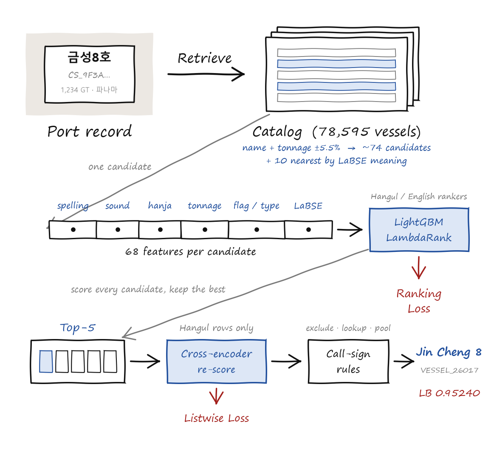
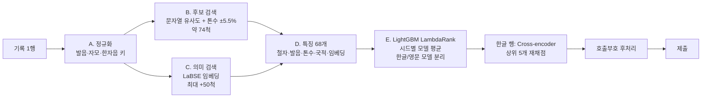

# 항만 입출항 기록 ↔ 선박 카탈로그 매칭 (DACON)

> **DS데이_선박매칭_검색랭킹모델** · 미팅 자료는 [docs/DS데이_선박매칭_검색랭킹모델.md](docs/DS데이_선박매칭_검색랭킹모델.md)

[DACON 경진대회 236771](https://dacon.io/competitions/official/236771)에 팀으로 참가하며 만든 코드입니다.
항만 입출항 기록 한 줄을 받아, 약 7만 9천 척이 담긴 선박 카탈로그에서 같은 배를 찾는 문제입니다.

- **최종 Public LB: 0.95240** (2026-11-01, 코드 제출 방식)
- 평가식: `0.7 × 한글 기록 정확도 + 0.3 × 영문 기록 정확도`
- 최종 제출 기준 정답 수(점수에서 역산): 한글 504 / 532행 (94.7%), 영문 3,440 / 3,568행 (96.4%)

## 문제가 어려운 이유

| 기록 (입력) | 카탈로그 (정답) | 어려운 점 |
|---|---|---|
| `금성8호` (예시) | `Jin Cheng 8` | 중국어 병음 이름을 한자음으로 적음 |
| `케이엠티씨 선전` | `KMTC Shenzhen` | 약어와 지명을 소리 나는 대로 적음 |
| `GRAND VICCTORY` | `GRAND VICTORY` | 영문 오타 |
| 톤수 없음, 국적 없음 | | 이름 하나로만 골라야 함 |

- 한글 기록은 표기 방식이 제각각입니다(소리, 한자음, 뜻 번역, 혼합, 줄임).
- 테스트 데이터에는 톤수 오차와 결측이 섞여 있습니다.

## 접근 방법

검색 → 특징 계산 → 순위 학습 → 재채점 → 규칙 기반 후처리로 이어지는 파이프라인입니다.

<p align="center"></p>



### 모델 구조

위쪽은 단계 구성이고, 아래쪽은 기록 한 줄이 각 단계를 지나며 바뀌는 모습입니다. 단계별 자세한 설명은 [docs/model_structure.md](docs/model_structure.md), 공부 순서는 [docs/study_plan.md](docs/study_plan.md)에 있습니다.

<p align="center"></p>

### 1. 한글 → 영문 표기 맞추기 (`inference/model/vessel_lib.py`, `hanja.py`)
- 한글 이름을 로마자 발음 키와 자모 키로 바꾸어 영문 이름과 비교합니다.
- 중국 선박명(병음)은 한자음 표로 바꿉니다. 예를 들어 `jin → 금/진`, `cheng → 성`이므로 `Jin Cheng → 금성`이 됩니다.
- 약어(`케이엠티씨 → KMTC`)와 대문자 약어 글자 읽기(`STI → 에스티아이`)도 처리합니다.

### 2. 순위 학습 (`training/train.py`)
- 후보마다 68개 특징을 만들고, LightGBM LambdaRank로 정답 선박이 1위에 오도록 학습합니다.
- 검증은 **선박 단위 GroupKFold(5)** 로 했습니다. 같은 배가 학습과 검증에 함께 들어가지 않게 해서 처음 보는 배에 대한 성능을 측정했습니다.
- 한글 행과 영문 행은 서로 다른 랭커가 맡습니다(`RowTypeSwitch`).

### 3. 데이터 증강
- **규칙 기반** (`training/augment.py`): 자모 오타, 띄어쓰기, 톤수 오차, 결측을 일부러 넣었습니다.
- **LLM 합성** (`llm_synthetic/`): Qwen2.5-7B-Instruct로 train 선박명을 다섯 가지 한글 표기 방식으로 작성해 학습 데이터에 더했습니다. 대회 규칙(train 데이터 기반 증강만 허용)을 지켰습니다.

### 4. 신경망 모듈 (Kaggle GPU에서 학습)
- **LaBSE 파인튜닝** (`labse_finetune/`): (한글 기록, 영문 선박명) 쌍으로 다국어 임베딩을 미세조정했습니다. 뜻을 번역한 표기(`해풍 → Sea Wind`)를 찾는 데 사용합니다.
- **Cross-encoder** (`cross_encoder/`): 랭커 상위 후보를 하드 네거티브로 사용해 listwise 손실로 학습했습니다. 한글 행의 상위 5개만 다시 채점합니다.

### 5. 호출부호 후처리 (`inference/script.py` → `callsign_postprocess`)
train에서 호출부호와 선박이 1:1로 대응한다는 점(5,851개 ↔ 5,851척)을 이용했습니다.
- **배제**: train에 없는 호출부호는 train에서 이미 다른 호출부호와 묶인 선박일 수 없습니다. 그래서 후보에서 제외합니다.
- **고정 조회**: train에 있는 호출부호이면 그 선박으로 확정합니다.
- **그룹 결정**: 같은 호출부호를 가진 행들은 확률을 합쳐 한 번에 결정합니다.
- 각 규칙에는 영문 행으로 스스로 검증하는 안전장치(gate)가 있습니다. 충돌이 많으면 그 규칙은 자동으로 꺼집니다.

이 후처리로 LB가 0.95147에서 0.95240으로 올랐습니다.

## 검증 방법: 스트레스 테스트 (`training/stress_eval.py`)

로컬 CV 점수가 0.99를 넘어도 LB와 차이가 컸습니다. 그래서 검증용 선박에 테스트와 비슷한 손상을 일부러 넣고 다시 채점했습니다.

| 조건 | 한글 정확도 | 영문 정확도 |
|---|---|---|
| 원본 | 99.66% | 99.95% |
| 톤수 제거 | 99.58% | 99.75% |
| 한글 자모 오타 | 99.50% | 99.95% |
| 이름만 (톤수·국적·선종 제거) | 97.40% | 99.75% |
| 복합 손상 (2~3개 동시) | 86.90% | 96.20% |

결과는 `analysis/stress_summary_*.csv`에 버전별로 남겨 두었습니다.

## 리더보드 분석

LB 점수의 소수점 자리를 역산해(`0.7·h/532 + 0.3·e/3568`) 제출마다 한글·영문 정답 수를 구했습니다. 그 결과 다음을 확인했습니다.

- 모든 제출에서 한글은 504/532에 머물렀습니다. 개선은 대부분 영문 행에서 나왔습니다.
- 톤수 노이즈 대응과 동명 선박 구분은 원인이 아니었습니다. 각각 LB와 시뮬레이션으로 확인했습니다.
- 남은 한글 오답은 대부분 창작에 가까운 표기였습니다. 28건 중 약 16건은 정답이 상위 5개 후보에도 없었습니다.

## 폴더 구조

```
inference/            최종 제출 코드 (DACON 서버에서 실행)
  script.py           진입점 + 호출부호 후처리
  model/vessel_lib.py 정규화, 후보 검색, 특징 68개, Matcher
  model/hanja.py      병음 → 한자음 표
  model/emb_feat.py   LaBSE 임베딩 특징
  model/ce_feat.py    Cross-encoder 재채점
training/             학습, 검증, 분석 스크립트
  train.py            랭커 학습 + CV + 제출 zip 생성
  augment.py          규칙 기반 증강
  stress_eval.py      손상 조건별 스트레스 검증
  ...
labse_finetune/       LaBSE 파인튜닝 (Kaggle 노트북 포함)
cross_encoder/        Cross-encoder 학습 (Kaggle 노트북 포함)
llm_synthetic/        LLM 합성 한글 기록 생성
llm_transliteration/  카탈로그 한글 표기 생성, LLM 객관식 채점 실험
analysis/             스트레스 검증 요약, 학습 곡선
docs/                 미팅 자료, 모델 구조 노트, 공부 계획
```

## 실행 방법

대회 데이터(`train.csv`, `vessel_catalog.csv`, `test.csv`)는 DACON 규정상 저장소에 포함하지 않았습니다. 학습된 가중치도 용량 때문에 제외했습니다.

```bash
pip install pandas numpy lightgbm rapidfuzz scikit-learn
python training/train.py --data <대회 데이터 폴더>
```

## 기술 스택
Python · pandas · LightGBM (LambdaRank) · rapidfuzz · PyTorch · Hugging Face Transformers (LaBSE, Cross-encoder) · Qwen2.5 (LLM 데이터 합성) · Kaggle GPU

## 참고
팀 프로젝트입니다. 일부 모델(한글 행 랭커와 cross-encoder 조합)은 팀원의 작업을 바탕으로 했습니다.
