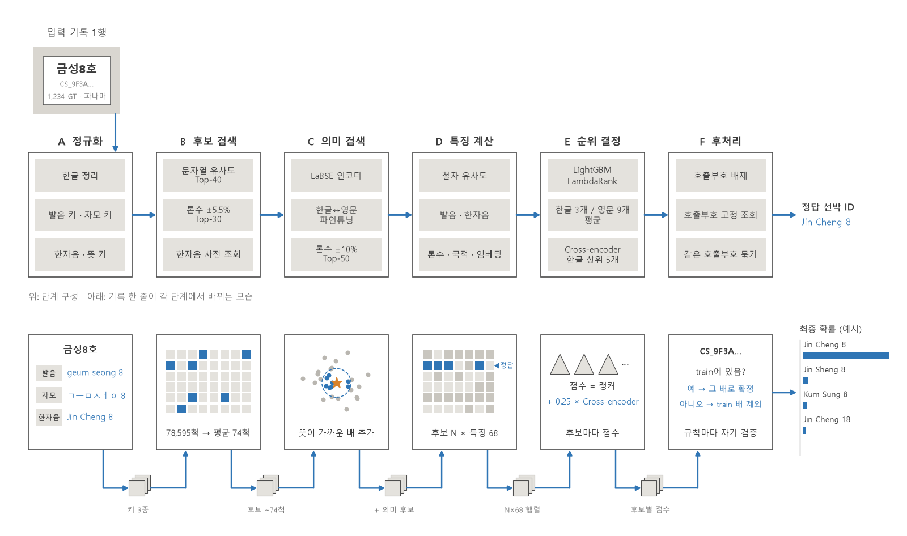

# DS데이_선박매칭_검색랭킹모델

> 항만에 들어온 배의 기록 한 줄을 보고, 7만 9천 척 규모의 선박 명부에서 **그 배가 어느 배인지** 찾아 주는 모델입니다.
> 최종 Public LB **0.95240**

### 목차

| 내용 | 코드 포함 |
|---|---|
| [이름에 담은 뜻](#이름에-담은-뜻) | |
| [30초 설명](#30초-설명) | |
| [`금성8호`가 정답이 되기까지 (①~⑤)](#금성8호가-정답이-되기까지) | ✅ 추론 코드 (단계마다 📄 표시) |
| [모델은 이렇게 학습했습니다](#모델은-이렇게-학습했습니다) | ✅ 학습 코드 |
| [코드 지도](#코드-지도) | ✅ 파일별 역할, 읽는 순서 |
| [결과](#결과) · [예상 질문](#예상-질문) | |

> 📄 표시가 붙은 부분이 **실제 코드**입니다. 파일 경로와 함수 이름을 함께 적었습니다. 전체 코드는 저장소의 `inference/`, `training/` 폴더에 있습니다.

---

## 이름에 담은 뜻

| 부분 | 뜻 |
|---|---|
| **선박매칭** | 이 문제는 분류가 아닙니다. 정답 후보가 78,595개인 **짝 찾기** 문제입니다. 기록과 명부의 배를 1:1로 이어 줍니다. |
| **검색랭킹** | 모델의 뼈대입니다. 후보를 먼저 **검색**하고, 학습한 모델이 후보의 **순위**를 매깁니다. 자연어 모델(LaBSE, cross-encoder)은 이 뼈대를 돕는 부품입니다. |

---

## 30초 설명

1. 기록의 선박명을 여러 방식(발음, 자모, 한자음, 뜻)으로 바꾸어 명부와 비교할 수 있게 만듭니다.
2. 명부에서 **후보를 100척 안팎으로** 추립니다.
3. 후보마다 **점수표 68칸**을 채우고, 순위 학습 모델이 **1위**를 고릅니다.
4. 마지막으로 **호출부호 규칙**으로 한 번 더 확인합니다.

<p align="center"></p>

---

## `금성8호`가 정답이 되기까지

기록 한 줄이 모델 안에서 어떻게 바뀌는지 처음부터 끝까지 따라가 보겠습니다.
(설명을 위해 만든 **가상 예시**입니다. 실제 데이터의 행이 아닙니다.)

```
입력  ─ vessel_name="금성8호", call_sign="CS_9F3A…", gross_tonnage=1234, flag_name="파나마"
정답  ─ 명부의 "Jin Cheng 8"
```

### ① 읽기 — 한글을 비교할 수 있는 형태로

> **입력** `금성8호` → **출력** 비교용 키 여러 개

명부에는 영문 이름만 있습니다. 그래서 먼저 한글 이름을 영문과 비교할 수 있는 형태로 바꿉니다.

| 만든 키 | 값 | 이 키로 잡는 경우 |
|---|---|---|
| 발음 | `geum seong 8` | 소리 나는 대로 적은 이름 |
| 자모 | `ㄱㅡㅁㅅㅓㅇ 8` | 한 글자 오타 |
| 한자음 | `Jin Cheng 8` | 중국 선박명을 한자음으로 읽은 경우 (金星 → 금성) |

📄 **코드** `inference/model/vessel_lib.py` — `class Query`

```python
class Query:
    def __init__(self, row, token_dict):
        name = row.get("vessel_name")
        self.hangul = is_hangul(name)
        self.ko_k = ko_key(name) if self.hangul else ""     # 한글 키
        self.ko_j = jamo(self.ko_k)                          # 자모로 분해
        if self.hangul:
            # 발음 키: 한글 → 로마자 → 발음 규칙
            self.pkey = phonetic(romanize(clean_hangul(name)), english=False)
        ...
        self.digits = digits_of(self.clean)                  # 숫자 "8"은 따로 보관
        self.g, self.ig = num(row.get("gross_tonnage")), num(row.get("international_gross_tonnage"))
```

> 💬 **핵심**: 기록 한 줄을 객체 하나로 만들어 두면, 이후 단계는 모두 이 객체만 보고 작업합니다.

### ② 좁히기 — 78,595척 → 100척 안팎

> **입력** 키 + 톤수 → **출력** 후보 번호 목록

여러 그물을 던져서 걸린 배를 **합집합**으로 모읍니다. 하나라도 걸리면 후보가 됩니다.

| 그물 | 걸리는 배 |
|---|---|
| 이름 유사도 상위 40척 | 이름이 비슷한 배 |
| 톤수 ±5.5% 안의 상위 30척 | 이름은 조금 달라도 크기가 맞는 배 |
| 톤수가 똑같은 배 | 이름을 바꾼 배 |
| 한자음·뜻 사전 | `금성` ↔ `Jin Cheng` |
| **LaBSE 의미 검색** (톤수 ±10% 안 최대 50척) | `해풍` ↔ `Sea Wind`처럼 뜻을 번역한 이름 |

📄 **코드** `vessel_lib.py` — `retrieve()`

```python
def retrieve(q, sim, idx, key_sims=(), top_name=40, top_gt=30):
    picks = [np.argpartition(-sim, top_name)[:top_name]]          # 이름 상위 40
    if HANJA and q.hangul and q.ko_k:
        picks.append(np.asarray(idx.hj_index.get(q.ko_k, [])))     # 한자음 사전
    win = np.union1d(idx.gt_window(q.g), idx.gt_window(q.ig))      # 톤수 ±5.5% 범위
    if len(win):
        k = min(top_gt, len(win))
        picks.append(win[np.argpartition(-sim[win], k - 1)[:k]])   # 범위 안 상위 30
    ...
    return np.unique(np.concatenate(picks))                        # 합집합
```

📄 **코드** `vessel_lib.py` — `Matcher.candidates()` 안의 의미 검색

```python
qv = EMB.vec(r.get("vessel_name"))            # 한글 기록 → 768차원 벡터 (LaBSE)
s = EMB.C @ qv                                 # 명부 전체와 코사인 유사도
win = np.flatnonzero(np.abs(self.idx.gt - g) <= EMB_TOL * g)   # 톤수 ±10%
cands = np.union1d(cands, win[np.argpartition(-s[win], k - 1)[:k]])
```

> 💬 **핵심**: 이 단계의 목표는 **정답을 놓치지 않는 것**(recall)입니다. 여기서 정답이 빠지면 뒤 단계에서 아무리 잘해도 맞힐 수 없습니다.

### ③ 점수표 — 후보마다 68칸

> **입력** 후보 N척 → **출력** N × 68 행렬

(기록, 후보) 한 쌍마다 얼마나 닮았는지를 숫자 68개로 기록합니다.

```
             철자  발음  한자음  숫자  톤수차  국적확률  …  LaBSE
Jin Cheng 8  0.62  0.71   1.00   1     0.00    0.81   …  0.77   ← 정답
Jin Sheng 8  0.58  0.66   0.00   1     0.03    0.81   …  0.74
Kum Sung 8   0.40  0.93   0.00   1     0.21    0.10   …  0.52
…
```
(값은 이해를 돕기 위한 예시입니다.)

📄 **코드** `vessel_lib.py` — `pair_features()` (특징 이름 목록은 `FEATURES`)

```python
for i in cands:
    rows.append([
        float(q.hangul), q.dict_cov,
        fuzz.ratio(qc, cc), fuzz.partial_ratio(qc, cc),                # 철자 유사도
        fuzz.token_sort_ratio(qt, ctx), fuzz.token_set_ratio(qt, ctx),
        JaroWinkler.similarity(qc, cc), Levenshtein.normalized_similarity(qc, cc),
        ...                                                            # 발음·한자음·톤수·국적 …
    ])
```

> 💬 **핵심**: 한글 기록과 영문 이름은 철자를 직접 비교해도 의미가 없습니다. 그래서 한글 기록이면 `qc, cc`에 **발음 키**를 넣어 비교합니다.
> ```python
> qc, cc = (q.pcomp, cp) if q.hangul else (q.comp, idx.comp[i])
> ```

### ④ 순위 매기기 — 학습한 모델이 1위를 고름

> **입력** N × 68 → **출력** 후보별 점수

두 모델이 차례로 점수를 매깁니다.

**(가) LightGBM LambdaRank**: 모든 후보에 점수를 매깁니다.
- 한글 기록은 한글 전용 모델 3개의 평균으로 채점합니다.
- 영문 기록은 영문 전용 모델 9개의 평균으로 채점합니다.

**(나) Cross-encoder**: 한글 기록만, 상위 5개 후보를 다시 채점합니다.
- 기록과 후보 이름을 **한 문장으로 붙여서** BERT에 넣습니다.
- 그래서 두 이름의 글자끼리 직접 비교할 수 있습니다.

📄 **코드** `vessel_lib.py` — `Matcher.predict()`

```python
sc = self.booster.predict(X)                               # (가) 랭커 점수
if CE is not None and q.hangul and len(cands) > 1:
    top = np.argsort(-sc, kind="stable")[:CE_TOP]          # 상위 5개만
    sc[top] += CE_W * CE.score(row.get("vessel_name"),     # (나) + 0.25 × cross-encoder
                               self.idx.names[cands[top]])
best = str(self.idx.ids[cands[int(np.argmax(sc))]])        # 1위
```

📄 **코드** `inference/script.py` — 한글·영문 모델 나누기

```python
class RowTypeSwitch:
    def predict(self, X):
        if self.other is not None and len(X) and X[0, 0] != 1.0:   # 0번 특징 = 한글 여부
            return self.other.predict(X)                            # 영문 행 → 영문 랭커
        return self.hangul.predict(X)                               # 한글 행 → 한글 랭커
```

### ⑤ 확인 — 호출부호 규칙

> **입력** 1위 후보 + 상위 20개 점수 → **출력** 최종 선박 ID

train에서는 **호출부호 1개 = 배 1척**입니다(5,851개 ↔ 5,851척). 이 성질로 모델의 답을 한 번 더 걸러냅니다.

```
CS_9F3A… 가 train에 있는가?
 ├─ 있음  → train의 그 배로 확정                                (고정 조회)
 └─ 없음  → train에서 이미 다른 호출부호와 묶인 배는 후보에서 제외     (배제)
            test에서 같은 호출부호를 가진 행끼리는 확률을 합쳐서 결정   (묶기)
```

📄 **코드** `inference/script.py` — `callsign_postprocess()`

```python
clash = sum(preds[i] != callsign_map[r["call_sign"]] for i, r, d in seen_eng)
hard = CS_HARD and clash <= 2 + 0.30 * len(seen_eng)       # 자기 검증 게이트
if hard:
    for i, r, d in seen:
        out[i] = callsign_map[r["call_sign"]]               # 고정 조회
...
if exclude:
    keep = [j for j, v in enumerate(ids) if v not in known] # 배제
p = np.exp((sc - sc.max()) / POOL_T)                        # softmax 확률
```

> 💬 **핵심**: 규칙을 무조건 켜지 않습니다. 먼저 정확도가 높은 **영문 행**에서 규칙과 모델 예측이 얼마나 어긋나는지 셉니다. 어긋나는 비율이 30%를 넘으면 그 규칙은 **스스로 꺼집니다**.

**결과**: 명부의 `Jin Cheng 8` 선박 ID를 제출합니다 ✅

---

## 모델은 이렇게 학습했습니다

### 순위 학습: 정답을 1위로 올리기

일반 분류는 후보 하나하나를 "정답이다 / 아니다"로 따로 맞힙니다.
순위 학습은 **기록 하나의 후보 전체를 한 묶음**으로 보고, 묶음 안에서 정답이 맨 위에 오도록 학습합니다.

📄 **코드** `training/train.py` — `PARAMS`, `weights()`, `fit_ranker()`

```python
PARAMS = dict(objective="lambdarank", n_estimators=600, learning_rate=0.03, num_leaves=31,
              lambdarank_truncation_level=10,
              monotone_constraints=[MONOTONE.get(f, 0) for f in FEATURES])  # "닮을수록 점수↑" 강제

def weights(hang, groups):                       # 평가식 0.7(한글) / 0.3(영문)을 학습에 반영
    w = np.where(hang, 0.7 / max(hang.sum(), 1), 0.3 / max((~hang).sum(), 1)) * len(hang)
    return np.repeat(w, groups)

def fit_ranker(Xs, ys, hang):
    X = np.vstack(...); y = np.concatenate(...)
    g = np.asarray([len(ys[i]) for i in keep])   # 묶음 크기 = 기록마다 후보 수
    return BoosterAverage([lgb.LGBMRanker(**(PARAMS | dict(random_state=42 + s)))
                           .fit(X, y, group=g, sample_weight=w) for s in range(N_SEEDS)])
```

### 한글 기록이 1,191개뿐이라서: 데이터 늘리기

| 방법 | 코드 | 만드는 것 |
|---|---|---|
| 규칙 기반 | 📄 `training/augment.py` | 자모 오타, 띄어쓰기, `호`/`제` 붙이기, 톤수 오차·결측 |
| LLM 합성 | 📄 `llm_synthetic/gen_synth.py` | Qwen2.5-7B로 train 선박명을 5가지 방식(소리, 한자음, 뜻, 혼합, 줄임)의 한글로 작성 |

### 신경망 부품 두 개 (Kaggle GPU에서 학습)

| | LaBSE (의미 검색) | Cross-encoder (재채점) |
|---|---|---|
| 입력 | 이름을 하나씩 따로 | 기록과 후보 이름을 붙여서 |
| 방식 | bi-encoder: 벡터끼리 비교 | 한 번에 읽고 점수 출력 |
| 속도 / 정확도 | 빠름 / 보통 | 느림 / 높음 |
| 쓰는 곳 | 명부 전체에서 후보 찾기 | 상위 5개만 |
| 학습 코드 | 📄 `labse_finetune/ft_labse.py` | 📄 `cross_encoder/ce_train.py` |
| 손실 | in-batch 대조 학습 | 정답 1개 vs 하드 네거티브 listwise softmax |

📄 **코드** 두 모델의 손실 함수

```python
# ft_labse.py — 배치 안에서 i번째 기록의 정답은 i번째 이름입니다 (나머지는 모두 오답)
loss = F.cross_entropy(logits, torch.arange(len(vids)))

# ce_train.py — 한 묶음(정답 + 랭커가 헷갈린 후보들)에서 정답(0번)을 고르도록 학습합니다
loss += F.cross_entropy(logits[o:o + len(grp)][None], torch.zeros(1, dtype=torch.long))
```

### 공정한 검증

- train에는 같은 배가 평균 2번 나옵니다. 그래서 **배 단위로 fold를 나누었습니다** (GroupKFold 5).
  - 기록 단위로 나누면 검증에 나온 배를 학습에서 이미 본 셈이 되어 점수가 부풀려집니다.
- 신경망 부품과 보조 사전도 **fold마다 따로** 만들었습니다. 랭커가 학습하는 점수에 검증 정보가 새어 들어가지 않게 하기 위해서입니다.
- 📄 `training/stress_eval.py`는 검증 기록에 일부러 손상을 넣고 다시 채점합니다.
  - 손상 종류: 오타, 톤수 제거, 국적 제거, 여러 손상 동시 적용
  - 어떤 조건에서 성능이 무너지는지 확인하기 위해 만들었습니다.

---

## 코드 지도

```
dacon-vessel-matching/
├── inference/                    ← 대회 서버에서 실제로 실행되는 코드
│   ├── script.py                 진입점 run() · 한글/영문 랭커 분기 · 호출부호 후처리 (⑤)
│   └── model/
│       ├── vessel_lib.py         ①~④ 전부: Query, retrieve, pair_features, Matcher
│       ├── hanja.py              병음 ↔ 한자음 표 (Jin → 금/진)
│       ├── emb_feat.py           LaBSE 벡터 생성
│       └── ce_feat.py            cross-encoder 채점
├── training/
│   ├── train.py                  랭커 학습 + 교차검증 + 제출 zip 생성
│   ├── augment.py                규칙 기반 증강
│   └── stress_eval.py            손상 조건별 검증
├── labse_finetune/               LaBSE 파인튜닝
├── cross_encoder/                cross-encoder 학습
└── llm_synthetic/                LLM으로 한글 기록 합성
```

| 단계 | 파일 | 함수 | 줄 |
|---|---|---|---|
| 진입점 | `inference/script.py` | `run()` | 160 |
| ① 읽기 | `inference/model/vessel_lib.py` | `class Query` | 394 |
| ② 좁히기 | `vessel_lib.py` | `name_sims()`, `retrieve()` | 432, 482 |
| ② 의미 검색 | `vessel_lib.py` | `Matcher.candidates()` | 698 |
| ③ 점수표 | `vessel_lib.py` | `FEATURES`, `pair_features()` | 526, 595 |
| ④ 순위 | `vessel_lib.py` | `Matcher.predict()` | 720 |
| ④ 한글/영문 분기 | `inference/script.py` | `RowTypeSwitch` | 24 |
| ⑤ 호출부호 | `inference/script.py` | `callsign_postprocess()` | 68 |
| 학습 | `training/train.py` | `fit_ranker()` | 101 |

**처음 읽는 순서**: `run()` → `Matcher.predict()` → `candidates()` → `Query` → `retrieve()` → `pair_features()` → `fit_ranker()`

---

## 결과

| | 점수 | 한글 정답 | 영문 정답 |
|---|---|---|---|
| 후처리 전 | 0.95147 | 504 / 532 | 3,429 / 3,568 |
| **최종 (후처리 후)** | **0.95240** | 504 / 532 (94.7%) | 3,440 / 3,568 (96.4%) |

정답 수는 점수에서 역산했습니다 (`0.7 × 한글/532 + 0.3 × 영문/3,568`).

**남은 과제**
- 남은 한글 오답 28건 중 약 16건은 정답이 상위 5개 후보 안에 없었습니다.
- 창작에 가까운 표기는 ② 좁히기 단계에서부터 놓친다는 뜻입니다.
- 다음 시도: LLM으로 검색 키를 더 만들기, 더 큰 cross-encoder 사용

---

## 예상 질문

<details><summary><b>Q. 딥러닝 하나로 하지 않고 트리 모델을 중심에 둔 이유는 무엇입니까?</b></summary>

- 한글 기록이 1,191개뿐이어서 큰 모델을 처음부터 학습하기 어려웠습니다.
- 발음·한자음·톤수 같은 도메인 지식은 사람이 설계한 특징으로 넣는 편이 확실했습니다.
- 그래서 신경망은 후보 찾기(LaBSE)와 재채점(cross-encoder)을 맡는 **부품**으로 붙였습니다.
</details>

<details><summary><b>Q. 분류가 아니라 순위 학습을 쓴 이유는 무엇입니까?</b></summary>

- 정답 후보가 78,595개여서 클래스마다 분류기를 둘 수 없습니다.
- 필요한 것은 "이 후보가 정답일 확률"이 아니라 "후보 중 누가 1위인가"입니다.
- LambdaRank는 1위 자리가 바뀌는 실수에 더 큰 벌점을 줍니다.
</details>

<details><summary><b>Q. LaBSE와 cross-encoder는 둘 다 BERT 계열인데 왜 둘 다 썼습니까?</b></summary>

- LaBSE는 이름을 미리 벡터로 만들어 둘 수 있어서, 7만 9천 척 전체를 빠르게 훑을 수 있습니다.
- cross-encoder는 두 이름을 함께 읽기 때문에 더 정확하지만 느립니다. 그래서 상위 5개에만 썼습니다.
- 정리하면 **넓은 범위는 빠른 모델로, 좁은 범위는 정확한 모델로** 처리했습니다.
</details>

<details><summary><b>Q. 호출부호 규칙이 테스트 데이터에서 맞지 않으면 어떻게 됩니까?</b></summary>

- 규칙마다 자기 검증 게이트가 있습니다.
- 영문 행에서 규칙과 모델 예측이 30% 넘게 어긋나면 그 규칙은 꺼지고, 모델의 답을 그대로 사용합니다.
</details>

<details><summary><b>Q. 과적합은 어떻게 막았습니까?</b></summary>

- 배 단위 GroupKFold로 검증했습니다.
- 보조 사전과 신경망을 fold마다 따로 만들었습니다.
- "닮을수록 점수가 높다"는 단조 제약을 걸었습니다.
- 일부러 손상을 넣는 스트레스 테스트로 확인했습니다.
</details>
