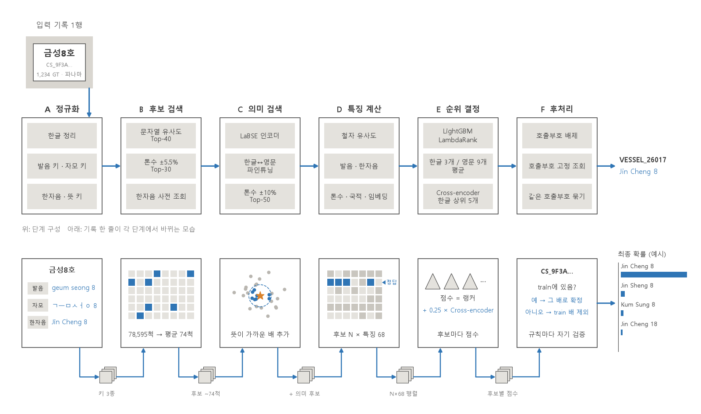

# 최종 모델 구조 공부 노트

최종 제출(Public LB 0.95240)이 기록 한 줄을 어떻게 처리하는지 단계별로 정리했어요.
면접에서 "이 모델 설명해 보세요"라는 질문에 답할 수 있도록 **무엇을 / 왜 / 어디 코드인지** 순서로 적었어요.

## 한 문장 요약

> 후보를 넓게 뽑고(검색), 후보마다 점수표를 만든 뒤(특징), 학습한 랭커가 1등을 고르고(순위),
> 마지막에 데이터의 규칙(호출부호)으로 한 번 더 걸러요.

이 구조를 **retrieve → rerank**(검색 후 재순위)라고 불러요. 검색 엔진과 추천 시스템이 쓰는 대표 구조예요.
카탈로그 78,595척을 전부 정밀하게 비교하면 너무 느려요. 그래서 싸고 빠른 방법으로 후보를 100척 안팎으로 줄이고, 비싼 모델은 그 후보에만 써요.

---

## A. 정규화: 한글을 비교할 수 있는 형태로 바꾸기

- **코드**: `inference/model/vessel_lib.py`의 `class Query`, `inference/model/hanja.py`
- **하는 일**: 기록 이름 하나로 비교용 키를 여러 개 만들어요.

| 키 | `금성8호`의 경우 | 잡아내는 표기 |
|---|---|---|
| 발음 키 | `geum seong 8` | 소리 나는 대로 적은 이름 (`글로비스 → Glovis`) |
| 자모 키 | `ㄱㅡㅁㅅㅓㅇ 8` | 한 글자 오타 (`굴로비스`) |
| 한자음 키 | `Jin Cheng 8` | 중국 배 이름을 한자음으로 적은 것 (`金星 → 금성`) |

- `호`, `제` 같은 접미사·접두사는 지우고, 숫자는 따로 떼어 둬요.
- **왜 필요한가**: 한글과 영문은 글자가 달라서 그대로는 비교할 수 없어요. 같은 문자 체계로 옮겨야 문자열 유사도를 쓸 수 있어요.

## B. 후보 검색: 78,595척 → 평균 74척

- **코드**: `vessel_lib.py`의 `name_sims()`, `retrieve()`
- **하는 일**: 아래 결과를 합집합으로 모아요.
  1. 이름 유사도 상위 40척 (rapidfuzz 문자열 유사도)
  2. 톤수 ±5.5% 범위 안에서 이름이 가장 비슷한 30척
  3. 톤수가 똑같은 배 (이름을 바꾼 배를 잡으려고)
  4. 한자음·뜻 사전에서 키가 일치하는 배
- **핵심 지표는 recall**이에요. 정답이 후보에 들어오기만 하면 뒤 단계에서 고를 수 있어요. 여기서 빠지면 그 행은 끝이에요.
  - 확인 코드: `training/recall_at_k.py`

## C. 의미 검색: LaBSE 임베딩

- **코드**: `inference/model/emb_feat.py`, 학습 `labse_finetune/ft_labse.py`
- **모델**: `setu4993/LaBSE`. 109개 언어의 문장을 같은 768차원 공간에 놓는 BERT 계열 인코더예요.
- **하는 일**: 한글 기록을 벡터로 바꿔요. 그리고 톤수 ±10% 범위 안에서 코사인 유사도가 가장 높은 배를 최대 50척 후보에 더해요.
- **왜 필요한가**: `해풍 → Sea Wind`처럼 뜻을 번역한 이름은 발음이 전혀 달라서 B 단계로는 못 찾아요.
- **파인튜닝**: (한글 기록, 영문 선박명) 쌍으로 대조 학습(contrastive learning)을 했어요.
  - 같은 배끼리는 벡터를 가깝게, 다른 배끼리는 멀게 만드는 방식이에요.
  - 단어 임베딩은 얼리고 트랜스포머 층만 학습했어요.
  - 검증에서 처음 보는 배가 섞이지 않도록 fold별로 따로 학습했어요.

## D. 특징 계산: 후보마다 68개 점수

- **코드**: `vessel_lib.py`의 `pair_features()`, 전체 목록은 `FEATURES`
- **하는 일**: (기록, 후보) 한 쌍마다 숫자 68개를 만들어서 후보 N개 × 68 행렬을 만들어요.

| 묶음 | 예시 특징 | 뜻 |
|---|---|---|
| 철자 | `ratio`, `jw`, `lev_norm`, `exact`, `prefix` | 문자열이 얼마나 비슷한지 (편집 거리, Jaro-Winkler) |
| 발음·한글 | `p_ratio`, `ko_ratio`, `kob_exact` | 발음 키와 카탈로그 한글 표기의 유사도 |
| 한자·뜻 | `hj_exact`, `hj_ratio`, `mn_ratio`, `is_pinyin` | 한자음·뜻 사전 일치 |
| 숫자 | `digits_eq`, `digits_conflict` | `8호`와 `8`이 같은지, 다른 숫자인지 |
| 톤수 | `gap_g`, `gt_exact`, `gt_in5`, `n_same_gt` | 톤수 차이, 같은 톤수인 배 수 |
| 국적·선종 | `flag_p`, `type_p` | train에서 배운 조건부 확률 |
| 단어 | `tok_jacc`, `idf_shared` | 희귀한 단어를 함께 쓰는지 |
| 임베딩 | `emb_sim`, `emb_rel` | LaBSE 코사인 유사도, 후보 안에서의 상대 순위 |

- **단조 제약(monotone constraint)**: "유사도가 높을수록 점수도 높아야 한다"를 모델에 강제했어요. 학습 데이터의 우연한 패턴에 과적합하는 것을 막아 줘요.

## E. 순위 결정: LightGBM LambdaRank + Cross-encoder

### E-1. LightGBM LambdaRank
- **코드**: `training/train.py`의 `fit_ranker()`, `PARAMS`
- **무엇인가**: 그래디언트 부스팅 트리로 순위를 학습하는 방법이에요.
  - 분류처럼 "이 후보가 정답인가"를 따로따로 맞히지 않아요.
  - 한 기록의 후보들을 **한 묶음(group)** 으로 보고, 정답이 1등에 오도록 학습해요.
- **LambdaRank 손실**: 순위 지표(NDCG)가 크게 바뀌는 쌍에 더 큰 그래디언트를 줘요. 그래서 1등 자리를 맞히는 데 집중해요.
- **설정**: 트리 600개, learning rate 0.03, leaf 31개, `lambdarank_truncation_level=10`
- **앙상블**: 시드만 다른 모델을 평균했어요(`BoosterAverage`).
  - 한글 행은 한글 전용 랭커 3개로 점수를 매겨요.
  - 영문 행은 영문 랭커 9개로 점수를 매겨요(`RowTypeSwitch`).
- **가중치**: 평가식(한글 0.7, 영문 0.3)에 맞춰 학습 샘플 가중치를 줬어요(`weights()`).

### E-2. Cross-encoder 재채점 (한글 행만)
- **코드**: `inference/model/ce_feat.py`, 학습 `cross_encoder/ce_train.py`
- **무엇인가**: 기록과 후보 이름을 **한 입력으로 붙여서** BERT에 넣고, 같은 배일 점수를 직접 출력해요.
  - LaBSE(C 단계)는 두 이름을 따로 벡터로 만들어 비교해요. 이런 방식을 **bi-encoder**라고 해요. 빠르지만 덜 정확해요.
  - Cross-encoder는 두 이름의 글자끼리 attention을 주고받아요. 정확하지만 느려요.
  - 그래서 랭커 상위 5개에만 써요.
- **최종 점수** = 랭커 점수 + 0.25 × cross-encoder 점수
- **학습**: 랭커가 헷갈려 한 상위 후보를 하드 네거티브로 썼고, listwise softmax 손실을 사용했어요.

## F. 호출부호 후처리

- **코드**: `inference/script.py`의 `callsign_postprocess()`
- **관찰**: train에서 호출부호와 선박은 정확히 1:1이에요(5,851 ↔ 5,851).
- **규칙 세 가지**

| 규칙 | 하는 일 |
|---|---|
| 배제 | train에 없는 호출부호는 train에 이미 다른 호출부호로 묶인 배일 수 없어요 → 후보에서 빼요 |
| 고정 조회 | train에 있는 호출부호면 → 그 배로 정해요 |
| 묶기 | test에서 같은 호출부호인 행들 → 확률(softmax)을 합쳐서 한 배로 정해요 |

- **자기 검증 게이트**: 각 규칙을 켜기 전에, 영문 행(정확도가 높은 쪽)에서 규칙과 모델 예측이 얼마나 충돌하는지 세요. 충돌이 많으면 그 규칙을 스스로 꺼요. 테스트 데이터가 가정과 다를 때를 대비한 안전장치예요.
- **효과**: LB 0.95147 → 0.95240

---

## 검증 방법: 왜 GroupKFold인가

- train에는 같은 배가 여러 번 나와요. 기록 단위로 나누면 검증에 나온 배를 학습에서 이미 본 셈이 돼서 점수가 부풀려져요.
- 그래서 **선박 단위 GroupKFold(5)** 로 나눴어요. 처음 보는 배에 대한 성능을 재는 방식이에요.
- 그래도 LB와 차이가 커서 **스트레스 테스트**(`training/stress_eval.py`)를 만들었어요. 검증용 기록에 오타, 톤수 오차, 결측을 일부러 넣어서 어디서 무너지는지 확인했어요.

## 면접 예상 질문

1. **왜 딥러닝 하나로 끝내지 않고 트리 랭커를 썼나요?**
   - 한글 기록이 1,191행 정도로 적어서 큰 모델을 처음부터 학습하기 어려웠어요.
   - 사람이 설계한 특징(발음·한자음·톤수)에 도메인 지식이 많이 들어 있었어요.
   - 신경망(LaBSE, cross-encoder)은 특징과 재채점 역할로 붙였어요.
2. **검색 단계에서 정답이 빠지면?** 그 행은 틀려요. 그래서 recall@K를 따로 쟀고, 검색 경로(한자음 사전, 같은 톤수, 의미 검색)를 계속 늘렸어요.
3. **한계는?**
   - 남은 한글 오답 28건 중 약 16건은 정답이 상위 5개에도 없었어요.
   - 창작에 가까운 표기는 검색 단계에서부터 놓쳤어요.
   - 다음에 시도할 방향은 LLM 기반 후보 생성이나 더 큰 cross-encoder예요.
4. **LB 점수를 어떻게 분석했나요?**
   - 한글 532행, 영문 3,568행이라 점수 = 0.7·h/532 + 0.3·e/3568이에요.
   - 소수점을 거꾸로 풀어서 제출마다 한글·영문 정답 수를 정확히 구했어요.

## 더 공부할 키워드

- Learning to Rank: pointwise / pairwise / listwise, LambdaRank, NDCG
- Gradient Boosting: LightGBM, monotone constraints
- Bi-encoder vs Cross-encoder, contrastive learning, hard negative mining
- Entity matching / record linkage
- 문자열 유사도: Levenshtein, Jaro-Winkler, token set ratio
